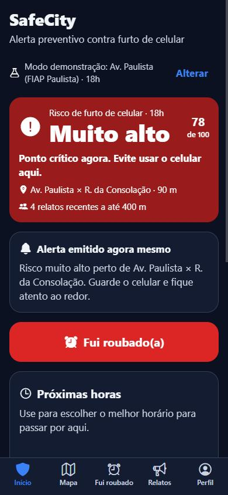
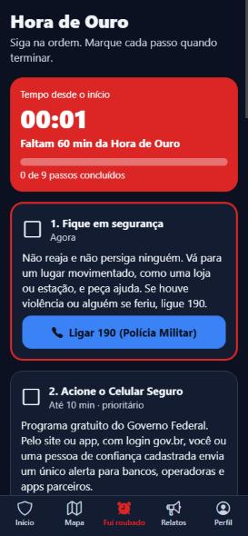
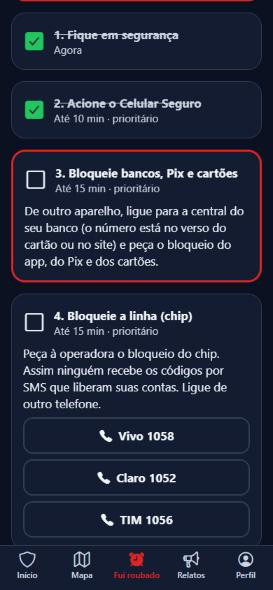
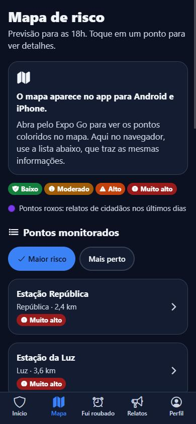
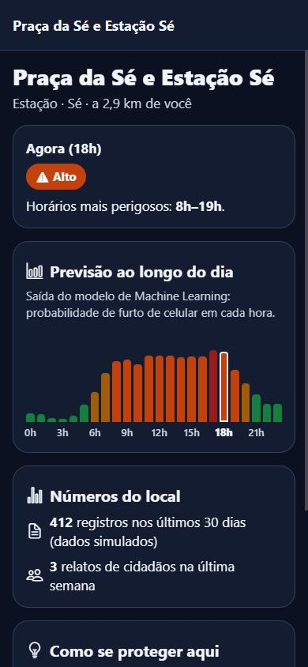
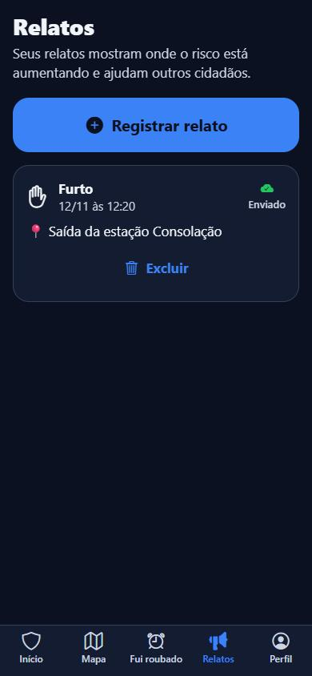
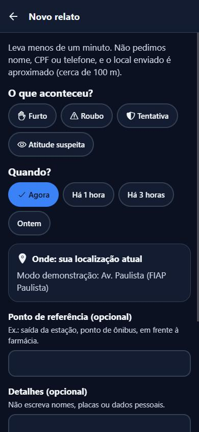
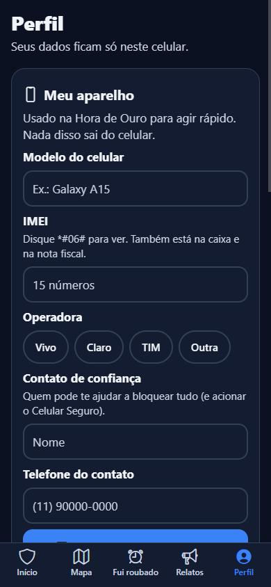

# SafeCity — Alerta Preventivo & Resposta Rápida

App mobile (Expo + React Native + TypeScript) da CitizenTech **SafeCity**, desenvolvido para a
Global Solution FIAP 2026.2 — disciplina **Mobile Development & IoT**.

> Avisa o cidadão quando ele está em um ponto e horário com alto risco de furto de celular e,
> se o furto acontecer, guia passo a passo pelos 60 minutos decisivos (a "Hora de Ouro").

---

## Ficha da CitizenTech

| Item | Resposta |
| --- | --- |
| **Nome** | SafeCity — Alerta Preventivo & Resposta Rápida |
| **Cidade e bairro** | São Paulo – SP · centro expandido (Sé, República, Luz, Brás, Av. Paulista/Consolação, Pinheiros, Santo Amaro) |
| **Cidadão beneficiado** | Trabalhador, estudante ou cidadão comum que anda a pé ou de transporte público e precisa usar o celular na rua |
| **Problema, em uma frase** | Quem circula a pé ou de transporte público não sabe onde e quando o risco de ter o celular furtado é maior e, quando o furto acontece, perde os minutos decisivos sem saber o que bloquear primeiro. |
| **Como funciona** | O app usa a localização (só no aparelho) e a previsão de risco por hora gerada pelo modelo de Machine Learning para emitir **alertas preventivos**. Se o furto acontecer, o botão **"Fui roubado(a)"** abre a **Hora de Ouro**: cronômetro + checklist com ligações e links prontos (Celular Seguro, banco, operadora, bloqueio do aparelho, BO, IMEI). Cidadãos também registram **relatos** anônimos que aumentam o risco do local em tempo real. |
| **O que cada parte faz** | **Mobile (este repositório):** app do cidadão — consulta o risco, recebe alertas, registra relatos e usa a Hora de Ouro. **IA & ML:** treina o modelo com dados públicos da SSP-SP e exporta o `riscoPorHora` de cada zona. **SOA / C#:** API que entrega `/zonas` e recebe `/ocorrencias` (mesmo contrato do mock). *Demais disciplinas: a equipe completa aqui.* |
| **Link do repositório** | https://github.com/AndreyRNagata/safecity-mobile |
| **Indicador de impacto** | **Tempo até concluir os 3 passos críticos** da Hora de Ouro (Celular Seguro + bancos + chip) — meta: menos de 15 min. Também medimos alertas preventivos recebidos e relatos registrados. Os três aparecem na tela **Perfil → Seu impacto**, calculados do banco local. |
| **ODS conectados** | **ODS 11** (11.2 transporte seguro e 11.7 espaços públicos seguros), **ODS 16** (16.1 reduzir a violência) e **ODS 9** (9.c acesso à tecnologia da informação) |

### Integrantes

| Nome | RM |
| --- | --- |
| Andrey Rodrigues Nagata | RM555339 |
| Henrique Soubhia | RM554493 |
| Oliver Kanai Trindade | RM554954 |
| Pedro Gutierre Cardoso de Oliveira | RM555445 |
| William Weile Feng | RM555132 |

### Vídeo (até 3 min)

https://youtube.com/shorts/evbYlH48gwg

---

## Jornada principal do cidadão

1. **Início** — "Qual o risco aqui, agora?" Nível (Baixo, Moderado, Alto, Muito alto), índice de 0 a 100,
   ponto de referência, relatos recentes por perto, gráfico das próximas 6 horas e dicas.
2. **Alerta preventivo** — ao entrar em um ponto de risco alto, o app vibra, mostra o aviso na tela,
   envia uma notificação local e anuncia no leitor de tela (no máximo 1 alerta a cada 30 min por local).
3. **Mapa** — pontos coloridos pelo risco do horário atual, relatos dos cidadãos e lista acessível
   com os mesmos dados (ordenada por risco ou distância). Cada ponto abre a previsão das 24 horas.
4. **Fui roubado(a) → Hora de Ouro** — cronômetro de 60 min e 9 passos em ordem de prioridade, com
   botões que ligam para 190, operadora e contato de confiança, abrem o Celular Seguro, o Encontre meu
   dispositivo, o iCloud e a Delegacia Eletrônica, e copiam o IMEI. O progresso fica salvo no SQLite.
5. **Relatos** — registrar furto, roubo, tentativa ou atitude suspeita em poucos toques. Salva no
   celular e envia para a API (ou fica na fila até a conexão voltar).
6. **Perfil** — IMEI (com validação), operadora e contato de confiança, preferências
   (alertas, texto maior, modo demonstração) e o painel **Seu impacto**.

## Telas

| Início | Hora de Ouro | Passos com ações |
| --- | --- | --- |
|  |  |  |

| Mapa (lista) | Detalhe do local | Relatos |
| --- | --- | --- |
|  |  |  |

| Novo relato | Perfil |
| --- | --- |
|  |  |

> Prints da versão web (mesmo código), em modo escuro e no modo demonstração (Av. Paulista, 18h).
> No celular, a aba Mapa mostra o mapa com os círculos de risco: **substitua `docs/prints/04-mapa.jpg`
> por um print do Expo Go** antes de entregar.

---

## Como rodar

### Pré-requisitos

- Node.js 20 ou superior
- App **Expo Go** no celular (Android ou iPhone), compatível com o **Expo SDK 58**

### Passo a passo

```bash
npm install
```

```bash
npx expo start
```

Leia o QR Code com o Expo Go (Android) ou com a câmera (iPhone). O celular e o computador precisam
estar na mesma rede Wi-Fi.

**Fora de São Paulo ou sem GPS?** Em **Perfil**, ligue o **Modo demonstração** e escolha o local
(ex.: Av. Paulista) e o horário (ex.: 18h) para ver o alerta preventivo disparar.

### Usando a API (opcional)

Sem configuração, o app usa os dados simulados embutidos. Para consumir dados por HTTP:

1. Suba o mock da API (json-server, porta 3000):

   ```bash
   npm run api
   ```

2. Copie `.env.example` para `.env` e preencha com o IP do computador na rede
   (no celular, `localhost` não funciona):

   ```
   EXPO_PUBLIC_API_URL=http://192.168.0.10:3000
   ```

3. Reinicie o Expo (`npx expo start -c`). Na tela Início aparece **"Previsões atualizadas pela API"**.

Para usar o backend da equipe (SOA / C#), basta apontar `EXPO_PUBLIC_API_URL` para ele, desde que siga
o contrato abaixo.

### Versão web (só para pré-visualizar)

```bash
npm run web
```

O mapa nativo não roda no navegador (a aba mostra a lista). O SQLite web só funciona com **uma aba
aberta por vez**.

### Scripts

| Comando | O que faz |
| --- | --- |
| `npm start` | Inicia o Expo (QR Code para o Expo Go) |
| `npm run api` | Sobe o mock da API em `http://localhost:3000` |
| `npm run api:reset` | Volta o mock da API aos dados originais |
| `npm run gerar-mock` | Gera de novo `mock-api/db.json` |
| `npm run typecheck` | Checagem de tipos do TypeScript |
| `npm run lint` | ESLint (config do Expo) |

---

## Consumo de dados

### Contrato da API

| Método | Rota | Corpo / resposta |
| --- | --- | --- |
| `GET` | `/zonas` | `ZonaRisco[]`: `id`, `nome`, `bairro`, `tipo`, `latitude`, `longitude`, `raioMetros`, `riscoPorHora` (24 números de 0 a 1), `ocorrenciasUltimos30Dias`, `dicas` |
| `GET` | `/ocorrencias` | Relatos anônimos: `tipo`, `latitude`, `longitude`, `ocorridoEm` |
| `POST` | `/ocorrencias` | Novo relato: `{ tipo, latitude, longitude, ocorridoEm }` (coordenadas arredondadas para ~100 m) |

### Estratégia offline-first

```
API (EXPO_PUBLIC_API_URL) ──falhou?──▶ cache no SQLite ──vazio?──▶ dados simulados embutidos
```

- Timeout de 6 s em cada requisição e **validação** do formato antes de usar os dados.
- A tela Início mostra de onde vieram as previsões: API, cache offline ou dados simulados.
- Relatos criados sem conexão ficam marcados como "Salvo só no celular" e são **enviados
  automaticamente** na próxima atualização com a API no ar.

### Como o risco é calculado (`src/services/risco.ts`)

```
risco = previsão do modelo para a zona na hora atual × proximidade + bônus por relatos recentes
```

- **Previsão do modelo:** `riscoPorHora[hora]` da zona (saída do modelo de ML da equipe).
- **Proximidade:** 1 dentro do raio da zona, caindo até 0 a 3× o raio.
- **Relatos recentes:** +0,05 por relato a até 400 m nos últimos 7 dias (máximo +0,15).
- **Níveis:** Baixo < 0,30 ≤ Moderado < 0,55 ≤ Alto < 0,75 ≤ Muito alto.

---

## Banco de dados (SQLite — `expo-sqlite`)

Arquivo `safecity.db`, criado e migrado em `src/db/banco.ts` (controle de versão por `PRAGMA user_version`).

| Tabela | Guarda |
| --- | --- |
| `configuracoes` | Preferências e dados do aparelho (IMEI, operadora, contato), em JSON |
| `relatos` | Relatos do usuário, com a flag `sincronizado` |
| `zonas_cache` | Última resposta válida da API, para uso offline |
| `alertas` | Histórico de alertas preventivos emitidos |
| `hora_ouro_sessoes` / `hora_ouro_passos` | Cada uso da Hora de Ouro e o horário em que cada passo foi concluído |

Os indicadores de impacto (`Perfil → Seu impacto`) são consultas SQL sobre essas tabelas.

---

## Acessibilidade

- Todos os elementos interativos têm `accessibilityRole`, `accessibilityLabel` e, quando útil,
  `accessibilityHint` e `accessibilityState` (selecionado, marcado, desabilitado, carregando).
- Área de toque mínima de **48 dp** em botões, chips e itens de lista.
- Contraste **WCAG AA** (≥ 4,5:1) nos modos claro e escuro (o app segue o tema do sistema).
- O nível de risco **nunca depende só da cor**: sempre tem ícone e texto.
- Opção **"Texto maior"** (+25%), além de respeitar o tamanho de fonte do sistema.
- O leitor de tela anuncia alertas, o início da Hora de Ouro e o resultado dos formulários.
- Gráficos têm descrição em texto; o mapa tem uma lista equivalente.
- Linguagem simples e direta, pensada para quem não é especialista.

## Privacidade e origem dos dados

- **Nenhum dado pessoal real** é usado. IMEI, contato de confiança e histórico ficam **só no SQLite do
  aparelho**; a API recebe apenas relatos anônimos (tipo, local aproximado e horário).
- A localização é usada **só no aparelho** para calcular o risco.
- **Zonas e relatos do mock são simulados** (`scripts/gerar-mock.js`, semente fixa). Os perfis por hora
  imitam o padrão dos dados abertos da SSP-SP (picos nos horários de deslocamento e na vida noturna),
  mas os números são fictícios.
- Telefones e links do guia foram conferidos em nov/2026: Celular Seguro (celularseguro.mj.gov.br),
  Vivo 1058, Claro 1052, TIM 1056 e a Delegacia Eletrônica da Polícia Civil de SP.

---

## Estrutura do projeto

```
src/
  app/                      # Rotas (Expo Router)
    _layout.tsx             # SQLiteProvider + estado global + Stack
    (tabs)/                 # Abas: Início, Mapa, Fui roubado, Relatos, Perfil
    zona/[id].tsx           # Detalhe de um ponto de risco
    relato/novo.tsx         # Formulário de relato (modal)
  components/               # UI acessível (ui.tsx), risco e mapa (nativo e web)
  constants/                # Tema, guia da Hora de Ouro, locais de demonstração
  context/app-context.tsx   # Estado global, carga de dados e monitor de alertas
  db/banco.ts               # SQLite: migração e consultas
  hooks/                    # Localização e tema
  services/                 # API, cálculo de risco e notificações
  types/                    # Tipos do domínio
mock-api/db.json            # Dados simulados (mock da API)
scripts/                    # Geração do mock e preparo do json-server
docs/prints/                # Prints das telas
prompts.md                  # Registro do uso de IA
```

## Tecnologias

Expo SDK 58 · React Native 0.88 · TypeScript · Expo Router (abas + stack + modal) · expo-sqlite ·
expo-location · expo-notifications (notificação local) · expo-haptics · expo-clipboard ·
react-native-maps · json-server (mock da API)

## Onde está cada critério da disciplina

| Critério | Onde ver |
| --- | --- |
| Telas e navegação | 5 abas + detalhe do local + modal de relato (`src/app`), com navegação por parâmetros (`/zona/[id]`, `/hora-de-ouro?iniciar=1`) |
| Consumo de dados | `src/services/api.ts` (GET/POST, timeout, validação) + `mock-api/` + fallback offline |
| Banco de dados | `src/db/banco.ts` (6 tabelas, migração, CRUD de relatos, progresso da Hora de Ouro, indicadores) |
| Acessibilidade | Seção acima; componentes em `src/components/ui.tsx` |
| Aderência ao problema | Alerta preventivo + Hora de Ouro + relatos colaborativos, com indicador de impacto |
| Documentação | Este README, prints, `prompts.md` e comentários no código |

## Uso de IA

A IA foi usada como copiloto. Os prompts e o que foi revisado pela equipe estão em [prompts.md](prompts.md).
